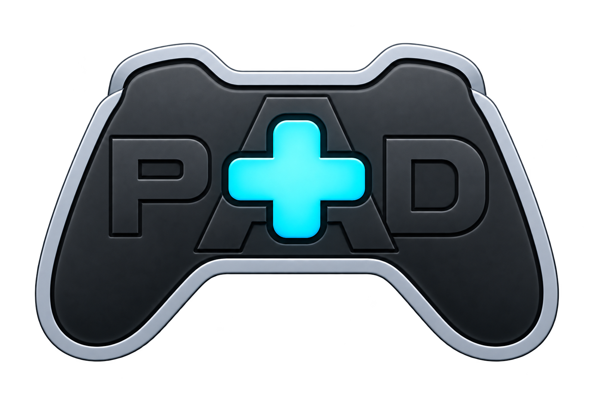

<p align="center">
  
</p>

<h1 align="center">PAD+ (PADPlus)</h1>

<p align="center">
  <strong>Puente moderno para mandos de Nintendo Switch 1 y Switch 2 con emulación universal DirectInput a XInput en Windows</strong><br>
  <em>Modern Nintendo Switch 1 & Switch 2 Controller Bridge with Universal DirectInput to XInput Emulation for Windows</em>
</p>

<p align="center">
  <a href="#-español"><b>🇪🇸 Leer en Español</b></a> &nbsp;•&nbsp; <a href="#-english"><b>🇬🇧 Read in English</b></a>
</p>

<p align="center">
  
  
  
  
  
</p>

---

# 🇪🇸 Español

## ⚡ Visión General

**PAD+** es un puente de control moderno y de alto rendimiento desarrollado en C# sobre **.NET 8**. Permite conectar mandos originales y de terceros de Nintendo Switch a tu PC con Windows, mapeándolos en tiempo real a mandos virtuales de **Xbox 360 (XInput)** o **DualShock 4** para máxima compatibilidad con cualquier juego o emulador.

PAD+ integra una interfaz moderna en **modo oscuro y ventana única** (sin ventanas emergentes flotantes), soporte completo para **mandos de Nintendo Switch 2**, un **puente universal DirectInput $\rightarrow$ XInput**, intercambio instantáneo de botones al estilo Xbox (A $\leftrightarrow$ B / X $\leftrightarrow$ Y) y ocultación de dispositivos a nivel de kernel mediante **HidHide** para eliminar la doble entrada (*ghost inputs*).

---

## ✨ Características Principales

* **🎮 Soporte Completo para Nintendo Switch 1 y Switch 2**:
  * **Switch 1:** Joy-Con (L), Joy-Con (R), Pro Controller, mandos retro de SNES, N64 y SEGA Genesis.
  * **Switch 2:** Joy-Cons de nueva generación (`0x2066`, `0x2067`), Switch 2 Pro Controller (`0x2069`) y mando GameCube Switch 2 (`0x2073`).
  * **Protocolo Nativo Switch 2 (Report `0x09`):** Lectura analógica de 12 bits de precisión (rango 0..4095), palancas traseras de agarre (**GL** / **GR**) y botón dedicado **CHAT**.
* **🕹️ Puente Universal DirectInput $\rightarrow$ XInput (`type = 4`)**:
  * Conecta mandos USB de terceros y gamepads genéricos para PC (como el **PDP Wired Fight Pad Pro**, mandos HORI, PowerA y adaptadores USB clásicos).
  * Decodifica automáticamente ejes analógicos de 8 bits, POV Hat de 8 direcciones y hasta 12 botones físicos directamente a un mando virtual Xbox 360.
* **🖥️ Interfaz Moderna en Ventana Única**:
  * Panel lateral derecho desplegable y totalmente integrado con pestañas dedicadas:
    * `[ ⚙ Ajustes ]` — Configuración en tiempo real con menús desplegables e interruptores.
    * `[ 🎮 Mapeo ]` — Intercambio rápido de botones Xbox (`Invertir A ↔ B`, `Invertir X ↔ Y`) y reasignación de botones/macros.
    * `[ 🕹️ Mandos 3rd ]` — Detección, asignación y gestión de mandos de terceros.
* **🛡️ Ocultación a Nivel de Kernel con HidHide**:
  * Oculta automáticamente el mando físico de Windows y de los juegos mediante **HidHide**, evitando que los juegos reciban tanto la entrada directa como la emulada ("doble pulsación").
  * Cierre seguro con temporizador asíncrono para evitar bloqueos del sistema al salir.
* **🎯 Bloqueo Anti-Desconexión para Steam**:
  * Escucha optimizada de eventos `WM_DEVICECHANGE` y enumeración sincronizada de hardware para erradicar el molesto ciclo de notificación *"Mando desconectado"* en Steam.
* **🔋 Slots Iluminados con Feedback de Batería en Neón**:
  * Bordes dinámicos iluminados cuyo color cambia según el nivel de carga (`#00E676` 100%, `#69F0AE` 75%, `#FFD740` 50%, `#FF9100` 25%, `#FF5252` Crítico).
  * Etiquetas de estado en tiempo real (`BT • 100%` o `USB • 100%`).
  * Menú contextual (clic derecho) para unir/separar Joy-Cons y vibración de identificación.

---

## 🚀 Primeros Pasos

### Requisitos Previos

1. **Sistema Operativo:** Windows 10 o Windows 11 (64 bits recomendado).
2. **Controladores (Drivers):**
   * **[ViGEmBus](https://github.com/nefarius/ViGEmBus/releases)** *(Obligatorio)*: Permite crear los mandos virtuales de Xbox 360 / DualShock 4.
   * **[HidHide](https://github.com/nefarius/HidHide/releases)** *(Recomendado)*: Oculta los mandos físicos para evitar la doble entrada en juegos y Steam.
   * Ambos instaladores se encuentran disponibles dentro de la carpeta `Drivers/`.

### Instalación y Uso

1. Descarga la versión más reciente desde la sección de [Releases](https://github.com/arsdaemonia-design/PADPlus/releases).
2. Instala **ViGEmBus** desde la carpeta `Drivers/` (reinicia tu PC si el instalador lo solicita).
3. Ejecuta **`PAD+.exe`**.
4. Conecta tu mando:
   * **Por Cable USB:** Conecta tu Pro Controller, soporte de carga o Fight Pad Pro a cualquier puerto USB. PAD+ lo detectará al instante.
   * **Por Bluetooth:**
     1. Mantén presionado el botón circular de sincronización (`SYNC`) en el mando hasta que los LEDs comiencen a parpadear en vaivén.
     2. Ve a *Configuración de Windows > Bluetooth y dispositivos > Agregar dispositivo* y emparéjalo.
     3. Una vez emparejado, presionar cualquier botón reconectará el mando automáticamente y PAD+ lo asignará a un slot disponible.

---

## 🛠️ Configuración de Mandos de Terceros / DirectInput

Si utilizas un mando USB de terceros (por ejemplo, **PDP Wired Fight Pad Pro for Nintendo Switch**):

1. Abre PAD+ y haz clic en **`🕹️ Mandos 3rd`** en la esquina inferior izquierda para abrir la pestaña de mandos externos.
2. En la sección **Dispositivos HID Detectados**, selecciona tu mando y presiona **`➕ Agregar a PAD+`**.
3. Selecciona el mando en la lista de dispositivos configurados y asigna su tipo:
   * **`Mando DirectInput Genérico (PC -> XInput)`** para gamepads USB estándar o adaptadores DirectInput.
   * **`Pro Controller (Switch)`** para réplicas inalámbricas que utilizan el protocolo propietario de Switch.
4. Presiona **`💾 Guardar y Aplicar`**. PAD+ volverá a escanear y asignará tu mando inmediatamente a un slot activo.

---

## 🏗️ Compilación desde el Código Fuente

### Requisitos
* [.NET 8.0 SDK](https://dotnet.microsoft.com/download/dotnet/8.0)
* Visual Studio 2022 o VS Code con C# Dev Kit

### Compilación por Línea de Comandos
```powershell
# Clonar el repositorio
git clone https://github.com/arsdaemonia-design/PADPlus.git
cd PADPlus

# Compilar en modo Release x64
dotnet build PADPlus.sln -c Release
```

El ejecutable compilado estará disponible en:
`PADPlus\bin\x64\Release\net8.0-windows\PAD+.exe`

---

## 👥 Créditos y Agradecimientos

* **[Benjamin Höglinger-Stelzer (Nefarius)](https://github.com/nefarius)** — Creador de [ViGEmBus](https://github.com/nefarius/ViGEmBus) y [HidHide](https://github.com/nefarius/HidHide), los controladores de kernel esenciales que hacen posible la emulación de mandos virtuales y la ocultación de dispositivos en Windows.
* **[David Khachaturov (Davidobot)](https://github.com/Davidobot)** — Autor original de [BetterJoy](https://github.com/Davidobot/BetterJoy), la base de código inicial para mandos Switch 1 sobre la que evolucionó PAD+.
* **[dekuNukem](https://github.com/dekuNukem/Nintendo_Switch_Reverse_Engineering) y [Nadeflore](https://github.com/Nadeflore)** — Documentación de ingeniería inversa para los protocolos HID de Nintendo Switch 1 y Switch 2.
* **[rajkosto](https://github.com/rajkosto)** — Creador de ScpToolkit y del protocolo del servidor UDP para control de movimiento.
* **[Looking-Glass](https://github.com/Looking-Glass/JoyconLib) y [mfosse](https://github.com/mfosse/JoyCon-Driver)** — Librerías pioneras de ingeniería inversa para Joy-Con.

---

## 📄 Licencia

Distribuido bajo la **Licencia MIT**. Consulta el archivo `LICENSE` para más información.

<br>
<p align="center">
  <a href="#pad-padplus">⬆️ Volver al inicio / Back to top</a>
</p>
<br>

---

# 🇬🇧 English

## ⚡ Overview

**PAD+** is an advanced, high-performance controller bridge written in C# on **.NET 8**. It allows you to connect original and third-party Nintendo Switch controllers to your Windows PC and map them to virtual **Xbox 360 (XInput)** or **DualShock 4** controllers system-wide.

PAD+ features a unified dark-mode interface with zero legacy floating popups, full support for **Nintendo Switch 2 controllers**, a universal **DirectInput $\rightarrow$ XInput bridge**, real-time hot-reloading for Xbox button layouts (A $\leftrightarrow$ B / X $\leftrightarrow$ Y), and kernel-level device cloaking to eliminate ghost inputs.

---

## ✨ Features

* **🎮 Complete Nintendo Switch 1 & Switch 2 Support**:
  * **Switch 1:** Joy-Con (L), Joy-Con (R), Pro Controller, SNES, N64, and SEGA Genesis controllers.
  * **Switch 2:** Next-gen Joy-Cons (`0x2066`, `0x2067`), Switch 2 Pro Controller (`0x2069`), and Switch 2 GameCube Controller (`0x2073`).
  * **Native Switch 2 Report `0x09`:** 12-bit analog stick precision (0..4095), rear grip paddles (**GL** / **GR**), and dedicated **CHAT** button support.
* **🕹️ Universal DirectInput $\rightarrow$ XInput Bridge (`type = 4`)**:
  * Seamlessly connects third-party USB and PC gamepads (such as the **PDP Wired Fight Pad Pro**, HORI pads, PowerA controllers, and generic USB adapters).
  * Automatically decodes 8-bit analog axes, 8-directional POV Hat, and up to 12 physical buttons directly into virtual Xbox 360 inputs.
* **🖥️ Unified Single-Window Modern UI**:
  * Clean, collapsible right-hand panel with integrated tabs:
    * `[ ⚙ Ajustes ]` — Real-time configuration table with dropdowns and toggles.
    * `[ 🎮 Mapeo ]` — Quick Xbox layout switches (`Invertir A ↔ B`, `Invertir X ↔ Y`) and button/macro remapping.
    * `[ 🕹️ Mandos 3rd ]` — Third-party controller discovery, assignment, and device management.
* **🛡️ Kernel-Level Cloaking with HidHide**:
  * Automatically hides the physical controller from Windows and games using **HidHide**, completely preventing "double-input" or conflicting key bindings.
  * Safe asynchronous timeout protection against driver stalls upon exit.
* **🎯 Anti-Disconnect Lock for Steam**:
  * Debounced `WM_DEVICECHANGE` listeners and synchronized hardware enumeration prevent the dreaded *"Controller Disconnected"* notification loop in Steam.
* **🔋 High-Contrast Illuminated Slots & Battery Feedback**:
  * Glowing neon borders that dynamically change color based on battery levels (`#00E676` 100%, `#69F0AE` 75%, `#FFD740` 50%, `#FF9100` 25%, `#FF5252` Low).
  * Real-time connection labels (`BT • 100%` or `USB • 100%`).
  * Right-click context menus for quick Joy-Con joining/splitting and haptic identification.

---

## 🚀 Getting Started

### Prerequisites

1. **Operating System:** Windows 10 or Windows 11 (64-bit recommended).
2. **Drivers:**
   * **[ViGEmBus](https://github.com/nefarius/ViGEmBus/releases)** (Required for virtual Xbox 360 controller emulation).
   * **[HidHide](https://github.com/nefarius/HidHide/releases)** (Recommended to prevent double-input in games and Steam).
   * Both installers are conveniently included in the `Drivers/` folder.

### Installation & Usage

1. Download the latest release from the [Releases tab](https://github.com/arsdaemonia-design/PADPlus/releases).
2. Install **ViGEmBus** from the `Drivers/` folder (restart your PC if prompted).
3. Run **`PAD+.exe`**.
4. Connect your controller:
   * **USB Mode:** Plug your Pro Controller, Charging Grip, or Fight Pad Pro into a USB port. PAD+ will detect it immediately.
   * **Bluetooth Mode:** 
     1. Hold the small circular `SYNC` button on the controller until the LEDs start cycling.
     2. Open Windows *Settings > Bluetooth & devices > Add device* and pair it once.
     3. Once paired, pressing any button will reconnect the controller automatically, and PAD+ will claim the slot.

---

## 🛠️ Third-Party / DirectInput Controller Setup

If you are using a third-party USB gamepad (e.g., **PDP Wired Fight Pad Pro for Nintendo Switch**):

1. Open PAD+ and click **`🕹️ Mandos 3rd`** in the bottom-left corner to open the third-party management tab.
2. Under **Dispositivos HID Detectados**, select your controller and click **`➕ Agregar a PAD+`**.
3. Select the controller in the configured list and choose:
   * **`Mando DirectInput Genérico (PC -> XInput)`** for generic USB/DirectInput gamepads.
   * **`Pro Controller (Switch)`** for wireless clone controllers that implement the proprietary Switch protocol.
4. Click **`💾 Guardar y Aplicar`**. PAD+ will re-scan and assign your controller to an active slot.

---

## 🏗️ Building from Source

### Requirements
* [.NET 8.0 SDK](https://dotnet.microsoft.com/download/dotnet/8.0)
* Visual Studio 2022 or VS Code with C# Dev Kit

### Command Line Build
```powershell
# Clone the repository
git clone https://github.com/arsdaemonia-design/PADPlus.git
cd PADPlus

# Build Release x64
dotnet build PADPlus.sln -c Release
```

The output executable will be generated at:
`PADPlus\bin\x64\Release\net8.0-windows\PAD+.exe`

---

## 👥 Credits & Acknowledgments

* **[Benjamin Höglinger-Stelzer (Nefarius)](https://github.com/nefarius)** — Creator of [ViGEmBus](https://github.com/nefarius/ViGEmBus) and [HidHide](https://github.com/nefarius/HidHide), the foundational kernel drivers enabling virtual controller emulation and device cloaking on Windows.
* **[David Khachaturov (Davidobot)](https://github.com/Davidobot)** — Original author of [BetterJoy](https://github.com/Davidobot/BetterJoy), the Switch 1 HID codebase from which PAD+ evolved.
* **[dekuNukem](https://github.com/dekuNukem/Nintendo_Switch_Reverse_Engineering) & [Nadeflore](https://github.com/Nadeflore)** — Reverse engineering documentation of Nintendo Switch 1 & Switch 2 HID protocols.
* **[rajkosto](https://github.com/rajkosto)** — Creator of ScpToolkit and the UDP motion server protocol.
* **[Looking-Glass](https://github.com/Looking-Glass/JoyconLib) & [mfosse](https://github.com/mfosse/JoyCon-Driver)** — Early Joy-Con reverse-engineering libraries.

---

## 📄 License

Distributed under the **MIT License**. See `LICENSE` for more information.

<br>
<p align="center">
  <a href="#pad-padplus">⬆️ Volver al inicio / Back to top</a>
</p>
